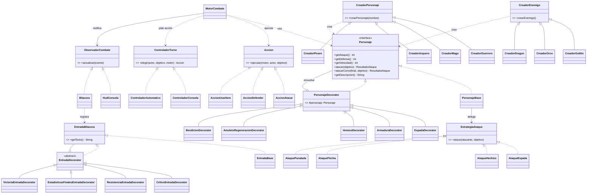

# Prototipo RPG por turnos — Strategy, Factory Method y Decorator (+ Observer y Command)

## Cómo ejecutar
```bash
mkdir -p out
javac -encoding UTF-8 -d out src/*.java
java -cp out Main            # modo interactivo (manual o automático)
./ejecutar_corridas.sh       # regenera EJECUCION.txt (4 corridas)
```
## Flujo de un turno (sección 8 del enunciado)
1. El jugador elige acción: **atacar, defender o usar ítem** (poción) → `ControladorConsola` devuelve un objeto `Accion` (**Command**).
2. `MotorCombate` ejecuta la acción; en un ataque invoca `heroe.atacar(enemigo)`.
3. El `Personaje` (posiblemente decorado) delega en su `EstrategiaAtaque` (**Strategy**).
4. El daño usa los atributos modificados por los decoradores (**Decorator**); si el objetivo se defiende, recibe la mitad.
5. El motor notifica a la **Bitácora** y al **HUD** (**Observer**).
6. Se alternan turnos hasta que alguien llega a 0 HP.

## Patrones
| Patrón | Uso | Clases |
|---|---|---|
| **Strategy** (obligatorio) | Forma de atacar | `EstrategiaAtaque`, `AtaqueEspada`, `AtaqueHechizo`, `AtaqueFlecha`, `AtaquePunalada` |
| **Factory Method** (obligatorio) | Creación de personajes y enemigos | `CreadorPersonaje` → `CreadorGuerrero/Mago/Arquero/Picaro`; `CreadorEnemigo` → `CreadorGoblin/Orco/Dragon` |
| **Decorator** (obligatorio) | Equipamiento combinable | `PersonajeDecorator` → `EspadaDecorator`, `ArmaduraDecorator`, `VenenoDecorator`, `AmuletoRegeneracionDecorator`, `BendicionDecorator` |
| **Decorator** (2º uso) | Bitácora enriquecible | `EntradaBitacora`, `EntradaBase`, `EntradaDecorator` → `CriticoEntradaDecorator`, `ResistenciaEntradaDecorator`, `EstadisticasFinalesEntradaDecorator`, `VictoriaEntradaDecorator` |
| **Observer** (opcional) | Bitácora y HUD | `ObservadorCombate`, `EventoCombate`, `Bitacora`, `HudConsola` |
| **Command** (opcional) | Acciones del turno | `Accion` → `AccionAtacar`, `AccionDefender`, `AccionUsarItem` |

Decoradores de equipo: **modifican atributos** (Espada, Armadura, Amuleto, Bendición) y **modifican `atacar`**
(Veneno agrega efecto DOT al resultado). El Amuleto usa además el hook `alFinalizarTurno()`.

### Nota de diseño: `atacarComo`
Se añadió `atacarComo(atacanteFinal, objetivo)` a `Personaje`. Sin él, `PersonajeBase.atacar` pasaría `this`
(el personaje sin decorar) a la estrategia y se ignorarían los bonos del equipamiento. Con `atacarComo`, la
estrategia recibe el objeto más externo de la cadena de decoradores.

## Reglas de combate
- **Defender:** recibes la mitad del daño hasta tu siguiente turno.
- **Poción:** el héroe tiene 2; cada una cura 30 HP (sin pasar de su HP máximo).
- **Veneno:** 3 de daño por turno durante 2 turnos, al inicio del turno del envenenado.
- **Amuleto:** +2 HP al final del turno del portador.
- **Enemigos:** IA automática (atacan; si están muy heridos pueden defenderse).

## Diagrama de clases (Mermaid)

